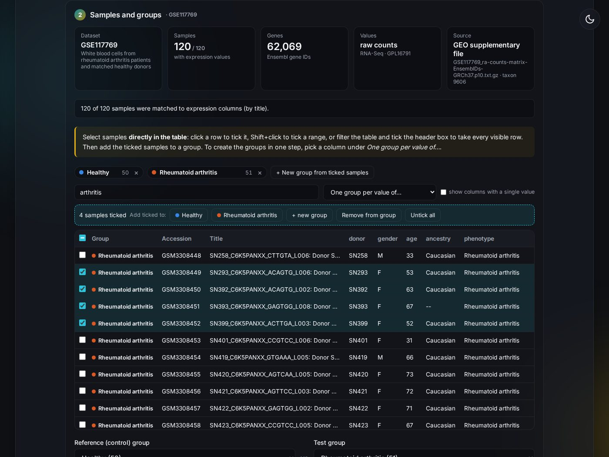
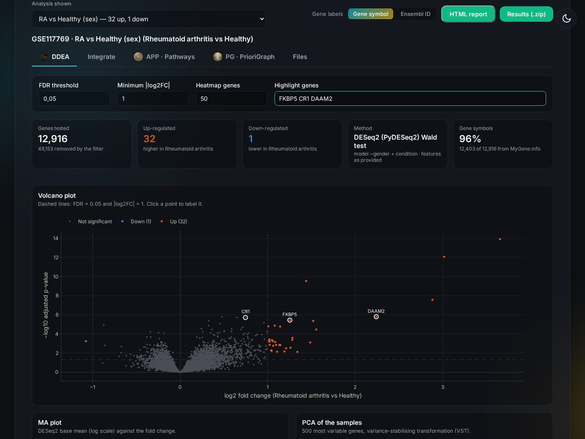
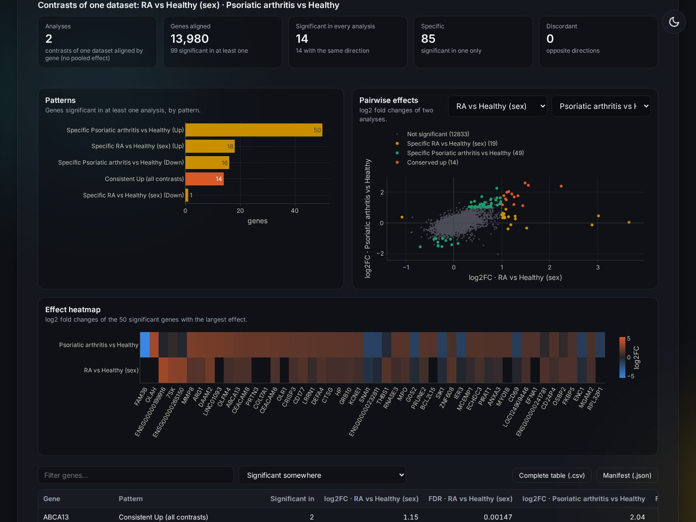
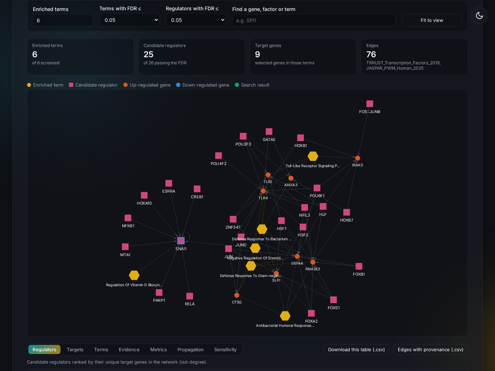

<div align="center">


# Lumos Networks

**A transparent three-stage workflow for transcriptomic analysis, functional context, and prior-knowledge networks**

<br/>

[](https://github.com/evomol-lab/lumos-networks/tree/flask-version)
[](#local-python)
[](#whats-new-in-version-20)
[](LICENSE)

[**⚠️ Important changes**](#important-changes) · [**Quick start**](#-quick-start) · [**What's new**](#-whats-new-in-version-20) · [**Modules**](#-what-each-module-computes) · [**Gallery**](#-interface-gallery) · [**Installation**](#-installation) · [**Scientific methods**](#-scientific-behaviour) · [**Team**](#-development-team)

</div>

---

Lumos Networks is a research application developed by EvoMol-Lab at BioME/UFRN. It runs on your own
computer as a local web interface (Flask, in the style of [Sauron](https://github.com/evomol-lab/Sauron)
and [The Room of Conformations](https://github.com/evomol-lab/roc)) and as a command line. The suite
contains three connected modules:

1. **DDEA — Diagonal Differential Expression Alley**
2. **APP — Arithmancy Pathway Profiler**
3. **PG — PrioriGraph**

Everything is explained in the **Documentation** tab of the interface ([DOCUMENTATION.md](DOCUMENTATION.md)).

<a id="important-changes"></a>

## ⚠️ Important changes in 2.1.0

> [!IMPORTANT]
> **The enrichment statistics of APP changed (FDR).** Version 2.0.0 sent the gene lists to Enrichr's
> Speedrichr service and, when Enrichr could not be reached (it refuses many server addresses), used a
> local test with a *different* multiple-testing correction, so the same data could give different
> results on a laptop and on a server. APP now always computes the one-sided hypergeometric test
> itself, on the Enrichr libraries, with the conventions of
> [clusterProfiler](https://doi.org/10.1089/omi.2011.0118): the universe is the background restricted
> to the genes annotated in the library, and Benjamini–Hochberg runs within each library over the
> tested terms (those with at least one query gene). **The results are the same on any computer or
> server.**

How the new results compare with Speedrichr (4 gene sources, 4 default libraries, 11,861 term tests):

| | Agreement |
|---|---|
| Same significant / not significant call (FDR < 0.05) | **99.1%** |
| Ranking of the terms (Spearman correlation of p-values) | **0.999** |
| Top-10 terms shared | **93.6%** |
| New significant terms that were already significant | **98%** (371 of 378) |
| Former significant terms still significant | 78% (371 of 475): GO 86%, KEGG 79%, JASPAR 100%, **TRRUST 6%** |

The new test is slightly stricter. The largest difference is **TRRUST**: it annotates few genes, and
Speedrichr counted the background genes absent from the library in the universe, which inflated its
significance. Expect fewer TRRUST regulators; PrioriGraph may relax the regulator FDR more often and
says so on screen.

Other changes worth knowing:

- **Gene lists are no longer cut**: APP used to keep only the first 3,000 genes of each list without
  warning; lists of up to 20,000 genes are used whole, larger ones are refused with a message.
- **New inputs**: differential-expression result tables computed elsewhere (DESeq2, limma, edgeR, Lumos
  exports) go straight to APP and PrioriGraph; your own regulator → target tables can be added to the
  regulator libraries (without an adjusted p-value their interactions are used as given).
- **Charts**: APP charts hide terms and regulators above the *FDR for the charts* (0.05 by default; the
  tables and files keep every term); PNG exports are drawn on white whatever the theme; the
  meta-analysis heatmap can be clustered; the sensitivity analysis exports every configuration.
- **Servers and closed networks**: the default Enrichr libraries ship inside the Docker image; Plotly,
  vis-network, marked, KaTeX and the Inter font are served by Lumos itself; the page works under a
  reverse-proxy sub-path; the image uses the waitress server, reports a newer release on Docker Hub at
  start-up, and its health check follows `LUMOS_PORT`.

<a id="quick-start"></a>

## 🚀 Quick start

With [Docker](https://docs.docker.com/get-docker/) or [Podman](https://podman.io/) installed, run

```bash
docker run --rm -p 5070:5070 docker.io/evomol/lumos-networks:2.0.0
```

and open <http://localhost:5070>. The image includes Python, R and limma. To keep your jobs, use the
command line or choose another port, see [Docker / Podman](#docker--podman).

<a id="whats-new-in-version-20"></a>

## ✨ What's new in version 2.0

- **Local web interface** replacing the Streamlit pages: numbered steps, background jobs with
  progress, log and cancellation, light and dark themes, and the whole session (datasets, analyses,
  integrations, enrichment) kept in the address bar.
- **Groups chosen directly in the sample table**: tick rows (Shift+click for ranges), filter by any
  column, or create one group per value of a metadata column in one click. The expression column
  matched to every sample is shown.
- **Optional Ensembl → gene symbol conversion**: Ensembl/Entrez IDs via MyGene.info (Ensembl REST as
  fallback), probes via the GEO platform annotation; a switch shows every plot, table and network with
  gene symbols or with the original IDs.
- **Several datasets and analyses per session**, each with optional batch, covariates and paired
  design, and one **Integrate** tab for contrasts of one dataset, random-effects meta-analyses and
  multi-tissue comparisons.
- **Interactive HTML report** of any tab, plus a JSON manifest for every analysis, integration and
  enrichment.

<a id="interface-gallery"></a>

### 🖥️ Interface gallery

<details open>
<summary><strong>Groups chosen in the sample table</strong></summary>



</details>

<details open>
<summary><strong>Differential expression, with gene symbols or Ensembl IDs</strong></summary>



</details>

<details open>
<summary><strong>Integration of analyses</strong></summary>



</details>

<details open>
<summary><strong>PrioriGraph</strong></summary>



</details>

<a id="what-each-module-computes"></a>

## 🧬 What each module computes

| Module | Implemented methods | Principal outputs |
|---|---|---|
| DDEA | PyDESeq2 Wald tests for raw integer RNA-seq counts; limma empirical-Bayes models for continuous expression; full-rank batch, covariate and paired-subject designs; alignment of contrasts; random-effects meta-analysis; multi-tissue alignment | Complete DE tables, design/contrast provenance, diagnostic figures, forest plots, cross-dataset alignment, JSON manifest, interactive HTML report |
| APP | Explicit-background ORA (hypergeometric test on the Enrichr libraries, computed locally), separated by expression direction by default; STRING v12 networks; TRRUST/JASPAR target-set enrichment | KEGG/GO tables with query/universe sizes and engine, STRING associations, candidate-regulator tables with provenance, JSON manifest, interactive HTML report |
| PrioriGraph | Enriched-term → gene and candidate TF → target integration; HITS, PageRank, betweenness; personalized RWR, signed linear propagation and parameter-grid sensitivity | Interactive network, edge provenance, structural rankings, propagation and stability tables, interactive HTML report |

The README deliberately uses **candidate regulator**, **association**, and **prior-knowledge
network**. The implemented workflow does not establish cohort-specific TF binding, regulatory
causality, or pathway activation.

<a id="analytical-workflow"></a>

## 🔄 Analytical workflow

> **DDEA → APP → PrioriGraph** — the three connected stages described below.

```text
GEO series or uploaded tables + groups chosen in the sample table
              │
              ▼
 DDEA: effect estimates + uncertainty (one or several analyses)
              │
              ├──▶ Integrate: contrasts · meta-analysis · multi-tissue
              ▼
 APP: ORA + STRING + TF target-set enrichment
              │
              ▼
 PrioriGraph: inspectable topology + propagation
```

Every step is a job stored on the server; CSV, JSON and HTML downloads provide durable, reviewable
hand-offs.

<a id="scientific-behaviour"></a>

## 🔬 Scientific behaviour

### DDEA

- Raw integer counts are validated before PyDESeq2. Fractional, negative, missing, or infinite values
  are rejected instead of silently truncated.
- The analysis unit is chosen per analysis: the features as provided (gene symbols are then labels
  that can be switched on and off), or gene symbols, in which case count features mapping to the same
  symbol are summed before PyDESeq2 and microarray probes are summarized by per-sample median.
- Count filtering retains genes with at least 10 counts in at least the size of the smaller group.
- Continuous matrices retain finite, non-constant features; non-log values are log2-transformed and
  microarrays quantile-normalized.
- The condition effect can be adjusted for batch, categorical/continuous covariates and paired
  subjects. Lumos rejects incomplete pairs and rank-deficient/confounded designs before model fitting.
- The publication route for microarrays and other continuous matrices uses Bioconductor limma with
  robust, trend-aware empirical-Bayes moderation. Welch is retained only as an explicitly labelled
  exploratory fallback (used automatically only when R/limma is not installed).
- A DEG must pass both the selected FDR and absolute effect threshold; thresholds can be changed on
  the results page without refitting.
- Several named analyses can be kept for one dataset. Integrated, their results are aligned by gene
  and classified as consistent, shared, specific, or discordant; reused samples are not treated as
  independent studies and no pooled effect is calculated.
- Meta-analysis is intended for independent datasets from the same tissue with comparable contrasts;
  it reports confidence intervals, Q, I², tau², study count, and contributing accessions.
  Multi-tissue comparison keeps effects from different tissues separate and supports more than two
  datasets.
- The strict conserved/consistent signature requires every analysis to pass both thresholds with the
  same direction. It never substitutes minimum FDR or a mean effect for concordance.

### APP

- APP currently performs **ORA**, not ranked-list GSEA.
- Every ORA requires an explicit measured-gene universe: by default all genes tested in the gene
  source; users may instead paste a custom universe. Query genes outside the universe are excluded and
  counted.
- Default libraries are `KEGG_2021_Human` and `GO_Biological_Process_2023`; any Enrichr library can
  be added, and library names and engines are retained in output tables.
- Up- and down-regulated lists are queried separately by default. Direction labels describe input
  lists; ORA alone does not infer activation/inhibition.
- `TRRUST_Transcription_Factors_2019` and `JASPAR_PWM_Human_2025` are queried independently and
  retained as an evidence-source column (ChEA 2022 and ENCODE/ChEA consensus are optional).
- Terms naming mouse, rat or murine experiments are removed by whole-word matching.
- STRING edges (functional or physical network) retain the returned score and are labelled
  associations.

### PrioriGraph

- Node rankings are calculated on the displayed TF → target subnetwork.
- TF-target exports preserve database, term, direction and adjusted p-value.
- Personalized RWR conserves probability at dangling nodes and exposes the restart probability.
- Sensitivity analysis perturbs FDR, absolute-effect, RWR-restart and propagation-decay parameters and
  reports configuration coverage, top-k frequency, rank IQR and score variability for every node.

<a id="installation"></a>

## ⚙️ Installation

### Docker / Podman

The recommended way to run Lumos Networks is the image
[`evomol/lumos-networks`](https://hub.docker.com/r/evomol/lumos-networks) on Docker Hub. It contains
Python, R and limma, so nothing else needs to be installed. The commands use `docker`; with
[Podman](https://podman.io/), write `podman` instead. Lumos needs an internet connection for GEO,
STRING and MyGene.info; the default Enrichr libraries (KEGG 2021, GO Biological Process 2023, TRRUST
2019, JASPAR PWM 2025) are inside the image, other libraries are downloaded when chosen.

**Updates.** At start-up the container compares its version with the releases on Docker Hub and, when
there is a newer one, says so in its log and at the top of the page (set `-e LUMOS_UPDATE_CHECK=0` to
turn this off). A container cannot replace itself; to always start the newest image, add
`--pull always`:

```bash
docker run --rm --pull always -p 5070:5070 docker.io/evomol/lumos-networks:latest
```

**1. Download the image** (once, and again to update):

```bash
docker pull docker.io/evomol/lumos-networks:2.0.0     # or :latest for the newest release
```

**2. Start the web interface** and open <http://localhost:5070>:

```bash
docker run --rm -p 5070:5070 docker.io/evomol/lumos-networks:2.0.0
```

Stop it with Ctrl+C. The jobs are kept inside the container and are lost when it stops. To keep them in
a folder of your computer, mount that folder:

```bash
mkdir -p lumos_jobs
docker run --rm -p 5070:5070 -v "$PWD/lumos_jobs":/opt/lumos/lumos_jobs docker.io/evomol/lumos-networks:2.0.0
```

In Windows PowerShell, write the folder as `-v "${PWD}\lumos_jobs:/opt/lumos/lumos_jobs"`.

| To | add to `docker run` |
|---|---|
| use another port, e.g. 8080 | `-p 8080:5070`, then open <http://localhost:8080> |
| run in the background | `-d --name lumos` (log: `docker logs -f lumos`; stop: `docker stop lumos`) |
| delete jobs older than 30 days at start-up | `-e LUMOS_JOB_RETENTION_DAYS=30` |
| mount folders on SELinux systems (Fedora, RHEL) | `:Z` at the end of each `-v` option |
| own the job files with rootful Docker on Linux | `--user "$(id -u):$(id -g)"` |
| run on an Apple-silicon Mac | `--platform linux/amd64` (the image is x86-64 and runs through emulation) |

**3. Command line.** The same image runs the engine on the files of the current folder:

```bash
alias lumos='docker run --rm -v "$PWD":/data -w /data docker.io/evomol/lumos-networks:2.0.0 python /opt/lumos/lumos.py'
lumos --help
lumos dataset --geo GSE117769 --outdir run/data
lumos de --dataset run/data --groups groups.json --reference Healthy --test RA \
    --covariate gender --outdir run/de
lumos enrich --source run/de --genes-up up.txt --genes-down down.txt --outdir run/app
```

**4. Check the image** (unit and engine tests, including limma):

```bash
docker run --rm docker.io/evomol/lumos-networks:2.0.0 python -m pytest -q /opt/lumos/tests
```

To build the image yourself from the repository: `docker build -t lumos-networks .` (with Podman,
`podman build --format docker -t lumos-networks .` keeps the health check).

### Local Python

Python 3.11 or newer.

```bash
git clone --branch flask-version https://github.com/evomol-lab/lumos-networks.git
cd lumos-networks
python -m venv .venv
source .venv/bin/activate          # Windows: .venv\Scripts\activate
python -m pip install --upgrade pip
python -m pip install -r requirements.txt
python LumosGUI.py                 # then open http://127.0.0.1:5070
```

limma also needs R with the Bioconductor package `limma` (`BiocManager::install("limma")`, or
`r-bioc-limma` on Debian/Ubuntu). Without it, continuous data use the Welch t-test and the interface
says so.

### Apptainer (HPC)

```bash
apptainer build lumos.sif docker://docker.io/evomol/lumos-networks:2.0.0   # from Docker Hub
apptainer build lumos.sif Apptainer.def                                     # or from the repository
mkdir -p lumos_jobs                                  # the image is read-only: jobs need a writable folder
apptainer run --bind lumos_jobs:/opt/lumos/lumos_jobs lumos.sif
```

### Command line

```bash
python lumos.py dataset --geo GSE117769 --outdir run/data
python lumos.py de --dataset run/data --groups groups.json --reference Healthy --test RA \
    --covariate gender --outdir run/de
python lumos.py enrich --source run/de --genes-up up.txt --genes-down down.txt --outdir run/app
```

Jobs are stored in `lumos_jobs/` (`LUMOS_JOBS_DIR`); `LUMOS_HOST`, `LUMOS_PORT` and
`LUMOS_JOB_RETENTION_DAYS` change the address and the clean-up.

<a id="tests"></a>

## ✅ Tests

Pure numerical functions live in `lumos_core.py`; the engine (`lumos.py`) is tested on synthetic data
without network access.

```bash
python -m pip install pytest
python -m pytest tests                      # all tests (limma tests run when R/limma is installed)
python -m unittest discover -s tests -v     # lumos_core unit tests
docker run --rm docker.io/evomol/lumos-networks:2.0.0 python -m pytest -q /opt/lumos/tests
```

The unit suite covers normalization, raw-count validation, experimental-design rank checks, paired
samples, GEO sample alignment, VST orientation, explicit ORA universes, benchmark metrics, conserved
signatures, RWR mass conservation and network sensitivity; the engine tests cover table parsing,
sample matching, DESeq2/limma/Welch runs that recover planted genes, design formulas, the three
integrations, PrioriGraph construction and the HTML report.

<a id="project-structure"></a>

## 🗂️ Project structure

```text
lumos-networks/
├── lumos.py             # engine and command line (dataset, de, integrate, enrich; PG, STRING, reports)
├── lumos_core.py        # pure, tested analytical helpers (design, alignment, ORA inputs, RWR, sensitivity)
├── lumos_report.py      # self-contained interactive HTML reports
├── LumosGUI.py          # Flask web interface (jobs, progress, downloads, on-demand networks)
├── r/limma_backend.R    # limma backend called through Rscript
├── templates/, static/  # page, style, script and images of the interface
├── DOCUMENTATION.md     # Documentation tab (methods, interpretation, outputs)
├── tests/               # unit and engine tests
├── Dockerfile, Apptainer.def, LumosGUI.spec   # container images and stand-alone executable
├── requirements.txt, pyproject.toml           # Python dependencies
├── CITATION.cff, zenodo.json, NOTICE, LICENSE
└── assets/, screenshots/                       # logos and README images
```

<a id="development-team"></a>

## 👥 Development team

- Dr. João Paulo M. S. Lima
- MSc. Laís de Carvalho Gonçalves
- Rodrigo Arruda Orvate

Laboratory of Molecular Evolution and Systems Biology (EvoMol-Lab), BioME,
Federal University of Rio Grande do Norte (UFRN), Natal, Brazil.

<a id="core-references"></a>

## 📚 Core references

- Love MI, Huber W, Anders S. Moderated estimation of fold change and dispersion
  for RNA-seq data with DESeq2. *Genome Biology*. 2014;15:550.
  <https://doi.org/10.1186/s13059-014-0550-8>
- Muzellec B, et al. PyDESeq2: a Python package for bulk RNA-seq differential
  expression analysis. *Bioinformatics*. 2023;39(9):btad547.
  <https://doi.org/10.1093/bioinformatics/btad547>
- Ritchie ME, et al. limma powers differential expression analyses for
  RNA-sequencing and microarray studies. *Nucleic Acids Research*. 2015;43(7):e47.
  <https://doi.org/10.1093/nar/gkv007>
- Xie Z, et al. Gene Set Knowledge Discovery with Enrichr. *Current Protocols*.
  2021;1:e90. <https://doi.org/10.1002/cpz1.90>
- Szklarczyk D, et al. The STRING database in 2023: protein-protein association
  networks and functional enrichment analyses for any sequenced genome of
  interest. *Nucleic Acids Research*. 2023;51(D1):D638-D646.
  <https://doi.org/10.1093/nar/gkac1000>
- Fornes O, et al. JASPAR 2020: update of the open-access database of
  transcription factor binding profiles. *Nucleic Acids Research*.
  2020;48(D1):D87-D92. <https://doi.org/10.1093/nar/gkz1001>
- Han H, et al. TRRUST v2: an expanded reference database of human and mouse
  transcriptional regulatory interactions. *Nucleic Acids Research*.
  2018;46(D1):D380-D386. <https://doi.org/10.1093/nar/gkx1013>
- Wu C, MacLeod I, Su AI. BioGPS and MyGene.info: organizing online, gene-centric
  information. *Nucleic Acids Research*. 2013;41(D1):D561-D565.
  <https://doi.org/10.1093/nar/gks1114>
- Hagberg AA, Schult DA, Swart PJ. Exploring network structure, dynamics, and
  function using NetworkX. *Proceedings of SciPy 2008*. 2008:11-15.

<a id="license-release-and-doi"></a>

## 📄 License, release and DOI

Copyright © 2026 EvoMol-Lab/BioME/UFRN. Lumos Networks is distributed under
the OSI-approved Apache License 2.0; see `LICENSE` and `NOTICE`.

`CITATION.cff` and `zenodo.json` provide release metadata for a tagged GitHub
release and Zenodo archival. 

Contact: jpmslima@gmail.com or lais.goncalves.034@ufrn.edu.br


---

<div align="center"><sub>Lumos Networks · EvoMol-Lab · BioME/UFRN</sub></div>
